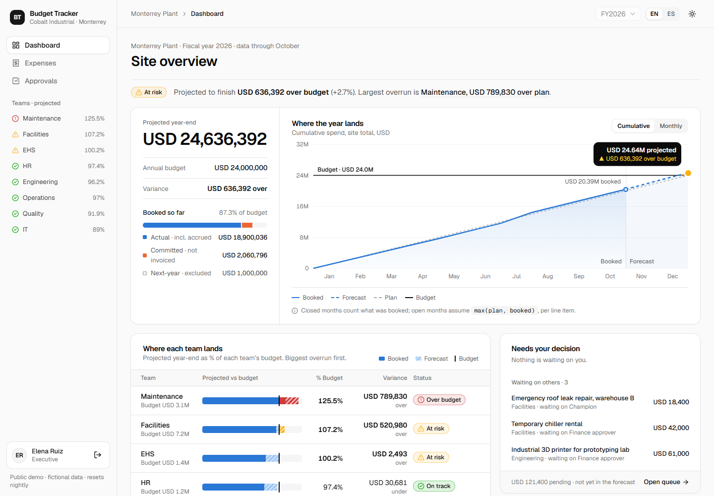
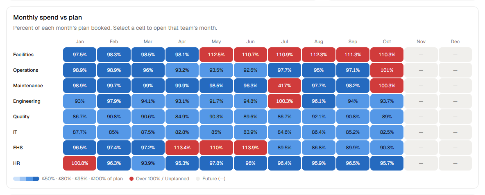
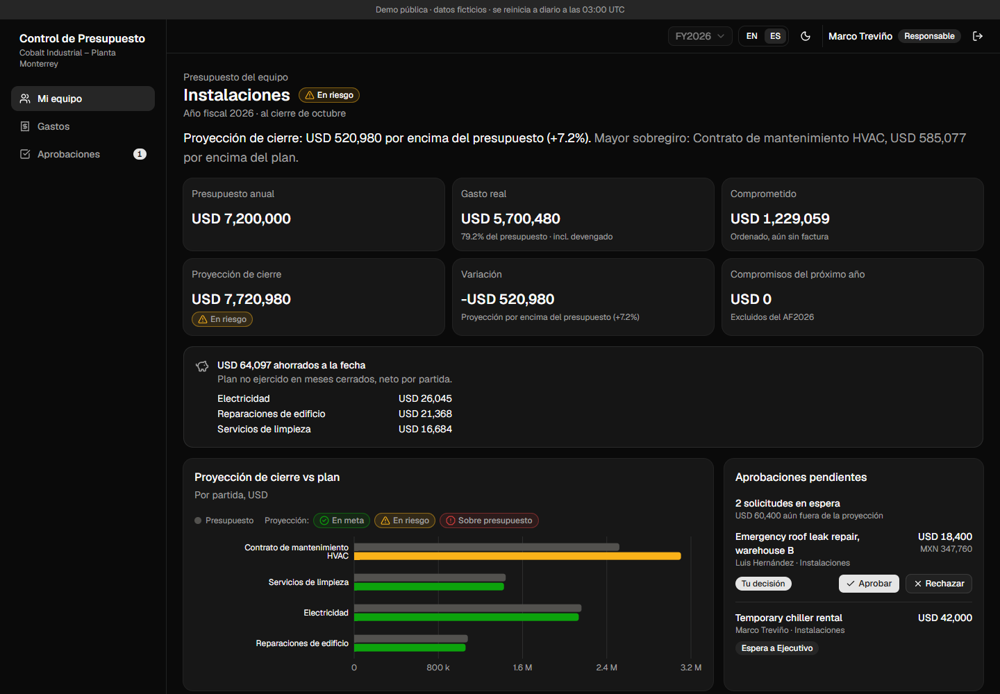
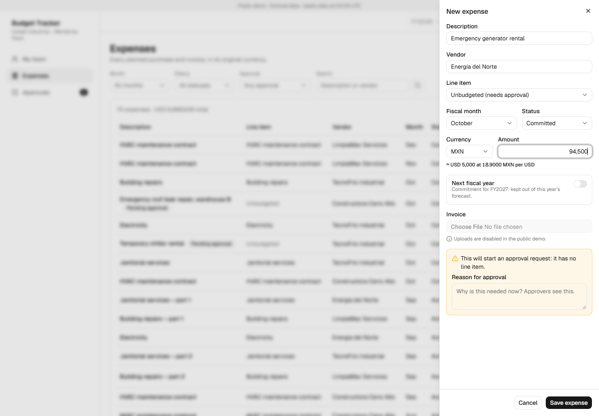
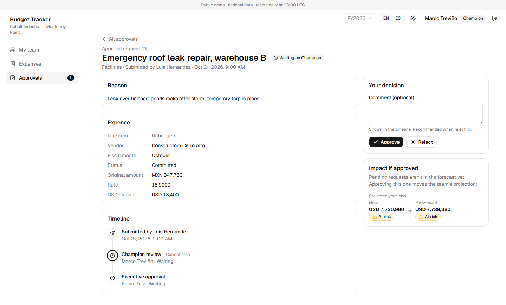

# Budget Tracker

[](https://github.com/angelarroyod/budget-tracker/actions/workflows/ci.yml)

A site budget tracker for a manufacturing plant that answers one question in ten seconds:
**where is spend today, and where will it land at year end?**

**[Live demo →](https://budget-tracker-ruby-nine.vercel.app)** · one-click roles, no sign-up · English / Español · light / dark



## The problem

A plant finished its fiscal year **$2M over budget**, and nobody could say where the money went.
Eight team owners ("champions") planned and tracked spend in separate spreadsheets; unbudgeted
purchases were approved by email; the executive only saw the total once it was too late.

I built an internal tool for this at a previous job. This repository is a **from-scratch,
open-source rebuild** with entirely fictional data (*Cobalt Industrial – Monterrey Plant, FY2026*),
so it can run as a public demo. No code, data or terminology comes from that employer.

## Try it

Pick a role on the login screen. Data resets every night (scheduled for 03:00 UTC; Vercel Hobby runs it within that hour), so click freely.

| Role | Try this |
|---|---|
| **Executive** | Read the headline, then follow *Largest overrun* → Maintenance. Click any heat-map cell to see that team's month. Approve or reject from *Pending approvals* and watch the KPIs move. |
| **Champion · Facilities** | *Expenses → New expense*: choose **Unbudgeted**, **MXN**, type `94,500`. The form converts live and explains why it will need approval. Then approve your delegate's roof-repair request in *Approvals*. |
| **Finance** | *Approvals → Waiting on me* only ever holds requests above the $25,000 threshold. Open one to see the timeline and what approving it does to the forecast. |

## What it does

- **Executive dashboard**: plain-language headline, KPI cards, projected vs budget by team, a team × month heat map, monthly planned / committed / actual, team table, and approvals with one-click decisions.
- **Team dashboard**: the same view for one team, plus line items, a savings callout, and a month drill-down from the heat map.
- **Expenses**: filterable list (filters live in the URL) and an add/edit form with live currency conversion. Unbudgeted or over-plan spend automatically opens an approval request.
- **Approvals**: *waiting on me / all pending / decided* queue and a request page with a step-by-step timeline, comments, and the forecast impact of approving.

## Decisions worth explaining

**One forecast rule, tested, everywhere.** Projected year-end is computed per line item per month:
past months count what was booked, open months assume the plan gets spent unless it's already
exceeded (`max(plan, booked)`). Summing per line item first means one item's overrun can't hide
behind another's unspent plan. The same pure function feeds every number on every screen, has
unit tests for each edge case, and was cross-checked to the cent against an independent SQL query.

**Red means one thing.** Red is reserved for "already over budget", amber for "projected over",
green for "on track", and every status also carries an icon and a label. A rejected approval is
shown with a neutral ✕ badge, never red, so red never cries wolf.

**Money is integer cents; floats never touch it.** Amounts are parsed as strings
(`parseFloat("0.29") * 100` is `28.999…`). Each expense keeps its original currency, the exchange
rate locked at entry (rounded to the 6 decimals the database stores *before* converting, so the
stored rate always reproduces the stored amount), and the converted USD amount.

**Approval rules live in one module.** Champion → Executive → Finance (only above a threshold).
A champion's own request skips their step; nobody can approve their own request; once an expense
is in the approval flow only its status can change, so an approved amount can't be raised later.
The request page shows what approving does to the team's projection, because pending money
isn't in the forecast yet.

**The server is the security boundary.** The demo login sets an HMAC-signed session cookie. Next.js
`proxy.ts` only does a fast cookie check; every page and action authorizes again next to the data
(champions get a 404, not a 403, for other teams' pages). Decisions run in a transaction with a row
lock, so a double click can't record two decisions.

**Localization is more than translation.** `es-MX`, not `es`: Mexico writes `1,234.56`, Spain
`1.234,56`. Translation keys are typed and a test fails if Spanish is missing one. A production-only
bug (*"as of September"* in October, because Vercel runs in UTC and the plant is UTC−6) led to
building month labels mid-month in UTC, with a test across UTC−11 to UTC+14.

**A public demo that cleans up after itself.** A Vercel Cron job calls `/api/reset` nightly, which
reloads a deterministic seed whose story is visible at a glance: Facilities at risk, Maintenance
already over after an $820k emergency purchase, savings in Quality and IT, a $1M microscope
committed for next year. The seed's random generator is re-created on every run, so a warm
serverless instance resets to byte-identical data (verified by fingerprinting the tables).

**Accessibility is checked, not assumed.** Lighthouse scores 100 on all seven main screens in
English and Spanish, light and dark. Getting there meant fixing real issues: a switch that lost
its label, link buttons announced as buttons, visible text missing from accessible names, and a
link distinguished by color alone. Data charts have table views; there's a skip link.

## Screenshots

| | |
|---|---|
|  |  |
| Heat map: % of each month's plan booked; red only above 100% | Team dashboard, Spanish, dark mode |
|  |  |
| Unbudgeted MXN expense: live conversion and approval hint | Approval request: timeline and forecast impact |

## Stack

Next.js 16 (App Router, server actions) · TypeScript · Tailwind CSS 4 · shadcn/ui (Base UI) ·
Recharts · next-intl · Drizzle ORM · Postgres (Neon in production, PGlite locally) · Vitest · Vercel

```
src/
  app/            routes: dashboard, teams/[id], expenses, approvals, login, api/reset
  components/     dashboard, expenses and approvals UI; ui/ is shadcn
  lib/            forecast, fx, approvals, session (pure + tested); queries and dal (server-only)
  db/             Drizzle schema and the deterministic seed
messages/         en-US and es-MX translations
```

See [SPEC.md](SPEC.md) for the full rules, data model and build plan.

## Run locally

No Docker or Postgres install needed: `db:local` runs an embedded Postgres (PGlite) on port 5432.

```bash
pnpm install
cp .env.example .env # then set SESSION_SECRET (32+ random characters)
pnpm db:local        # terminal 1: keep running
pnpm db:migrate      # terminal 2
pnpm db:seed
pnpm dev
```

| Script | What it does |
|---|---|
| `test` | Unit tests (forecast, FX, approvals, session, form parsing, translations) |
| `typecheck` | Generate Next route types, then `tsc` |
| `db:local` | Embedded Postgres, data in `.pglite/` |
| `db:generate` | New SQL migration from `src/db/schema.ts` |
| `db:migrate` | Apply migrations to `DATABASE_URL` |
| `db:seed` | Wipe and reload the deterministic demo data |
| `db:studio` | Browse the database in Drizzle Studio |

## Deploying

On Vercel with the Neon integration. Environment variables:

| Variable | Value |
|---|---|
| `DATABASE_URL` | Neon pooled connection string (set by the Vercel Neon integration) |
| `SESSION_SECRET` | 32+ random characters; signs the demo session cookie |
| `CRON_SECRET` | Random string; Vercel Cron sends it to `/api/reset` (scheduled in `vercel.json`) |

## Not in this version

CSV/Excel budget import · month close with adjustment entries · settings screen · real
authentication · notifications. They're scoped in [SPEC.md](SPEC.md); month close is next.

## License

[MIT](LICENSE). All data is fictional.
