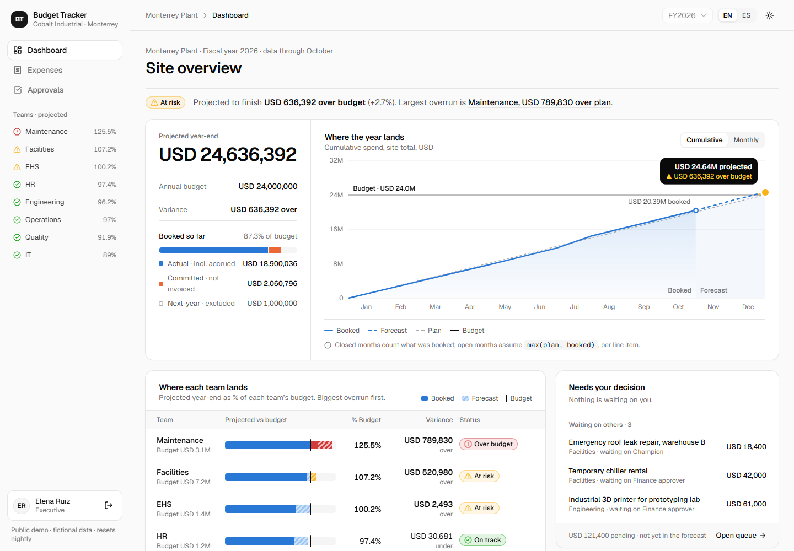
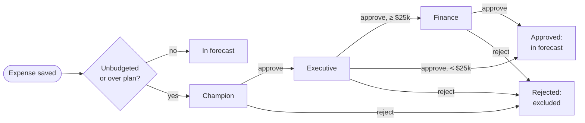
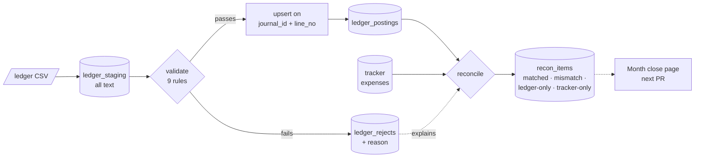
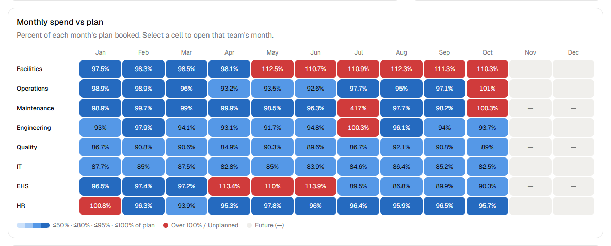
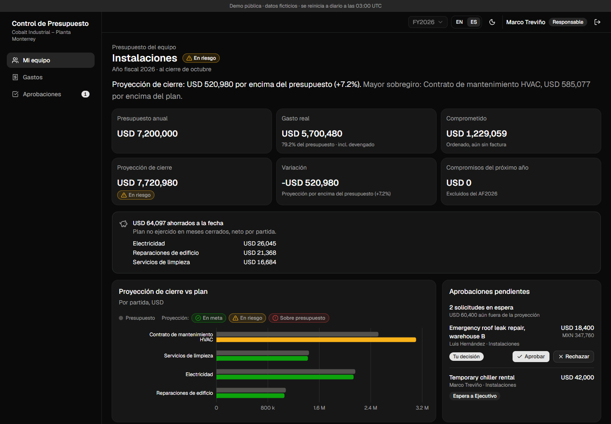
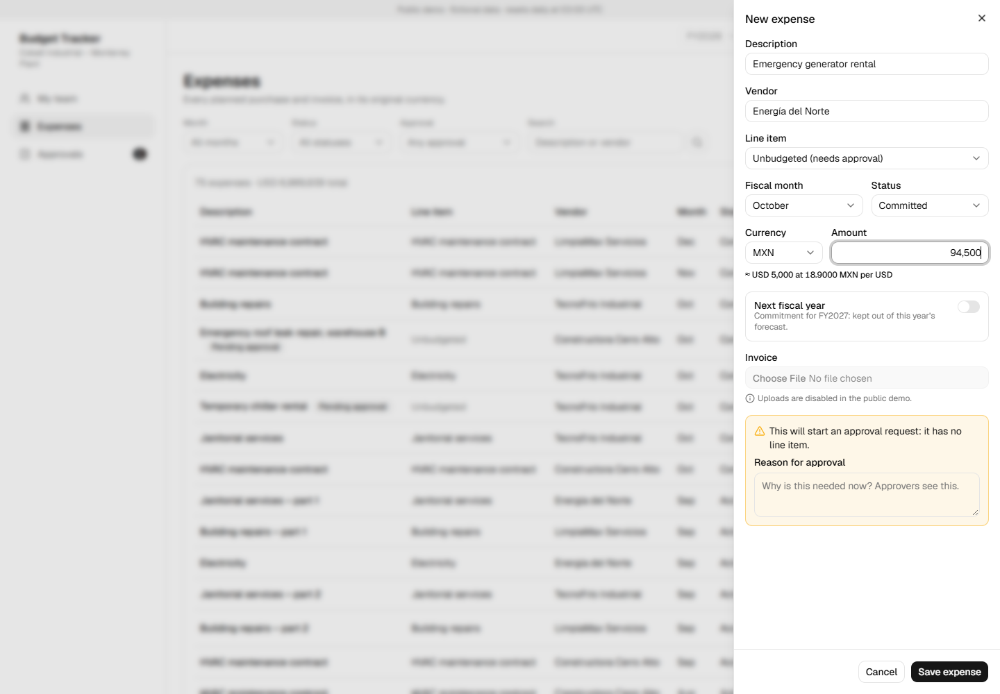
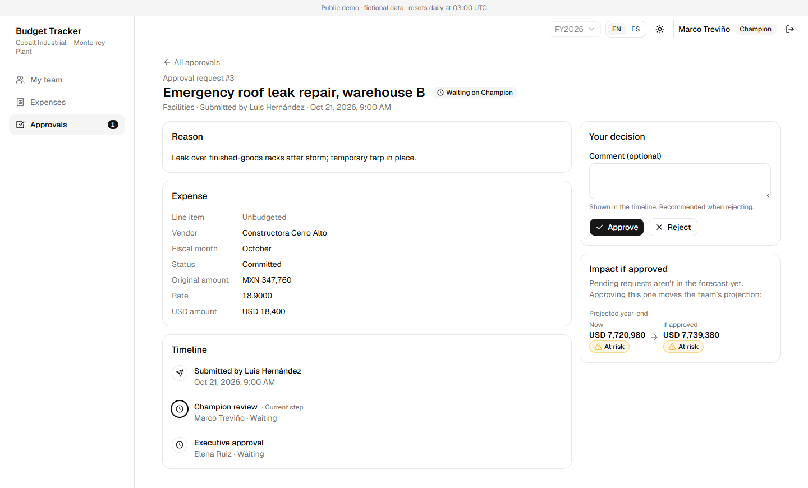

# Budget Tracker

[](https://github.com/angelarroyod/budget-tracker/actions/workflows/ci.yml)

A site budget tracker for a manufacturing plant that answers one question in ten seconds:
**where is spend today, and where will it land at year end?**

**[Live demo →](https://budget-tracker-ruby-nine.vercel.app)** · one-click roles, no sign-up · English / Español · light / dark



## The problem

A plant finished its fiscal year **$2M over budget**, and nobody could say where the money went.
Eight team owners ("champions") planned and tracked spend in separate spreadsheets; unbudgeted
purchases were approved by email; the executive only saw the total once it was too late.

I built an internal tool for this at a previous job. This repository is a **from-scratch,
open-source rebuild** with entirely fictional data (*Cobalt Industrial – Monterrey Plant, FY2026*),
so it can run as a public demo. No code, data or terminology comes from that employer.

## Try it

Pick a role on the login screen. Data resets every night (a scheduled job around 03:00 UTC), so click freely.

| Role | Try this |
|---|---|
| **Executive** | Read the status line, then follow *Largest overrun* → Maintenance. Click any heat-map cell to see that team's month. Approve or reject from *Needs your decision*, which says up front what approving does to the forecast, and watch the projection move. |
| **Champion · Facilities** | *Expenses → New expense*: choose **Unbudgeted**, **MXN**, type `94,500`. The form converts live and explains why it will need approval. Then approve your delegate's roof-repair request in *Approvals*. |
| **Finance** | *Approvals → Waiting on me* only ever holds requests above the $25,000 threshold. Open one to see the timeline and what approving it does to the forecast. |

## What it does

- **Executive dashboard**: a status line in plain language; projected year-end beside a cumulative burn-up chart (booked, forecast to December, plan, budget, with the overrun shaded; a toggle switches to monthly planned / committed / actual); *where each team lands* as % of budget, booked solid and forecast hatched; approvals you decide in two steps (the confirm names the amount); and a team × month heat map with a year-to-date column and a one-line explanation of the hottest month. The sidebar lists every team's projected landing, worst first.
- **Team dashboard**: the same view for one team, plus line items, a savings callout, and a month drill-down from the heat map.
- **Expenses**: filterable list (filters live in the URL) and an add/edit form with live currency conversion. Unbudgeted or over-plan spend automatically opens an approval request.
- **Approvals**: *waiting on me / all pending / decided* queue and a request page with a step-by-step timeline, comments, and the forecast impact of approving.

## Decisions worth explaining

**One forecast rule, tested, everywhere.** Projected year-end is computed per line item per month:
past months count what was booked, open months assume the plan gets spent unless it's already
exceeded (`max(plan, booked)`). Summing per line item first means one item's overrun can't hide
behind another's unspent plan. The same pure function feeds every number on every screen, has
unit tests for each edge case, and was cross-checked to the cent against an independent SQL query.

**Red means one thing.** Red is reserved for "already over budget", amber for "projected over",
green for "on track", and every status also carries an icon and a label. A rejected approval is
shown with a neutral ✕ badge, never red, and a heat-map month above its plan is amber with a ▲ (one hot month
doesn't mean the team is over budget), so red never cries wolf. Money that is forecast but not yet
spent is hatched, never solid, so a bar never shows spend that hasn't happened.

**The dashboard leads with the answer.** The first thing on the page is where the year lands and by
how much; the chart beside it shows how it gets there. Every figure, including the heat map's
"why" line (the hottest over-plan month and the biggest expense in it), is computed from the data,
so the story stays true after each nightly reset.

**Money is integer cents; floats never touch it.** Amounts are parsed as strings
(`parseFloat("0.29") * 100` is `28.999…`). Each expense keeps its original currency, the exchange
rate locked at entry (rounded to the 6 decimals the database stores *before* converting, so the
stored rate always reproduces the stored amount), and the converted USD amount.

**Approval rules live in one module.** Champion → Executive → Finance (only above a threshold).
A champion's own request skips their step; nobody can approve their own request; once an expense
is in the approval flow only its status can change, so an approved amount can't be raised later.
The request page shows what approving does to the team's projection, because pending money
isn't in the forecast yet.



The champion step is skipped when the champion raised the request. A pending request isn't in the forecast yet.
Next-year commitments on a budgeted line item skip the plan check, since they don't touch this year's plan.

**The server is the security boundary.** The demo login sets an HMAC-signed session cookie. Next.js
`proxy.ts` only does a fast cookie check; every page and action authorizes again next to the data
(champions get a 404, not a 403, for other teams' pages). Decisions run in a transaction with a row
lock, so a double click can't record two decisions.

**Localization is more than translation.** `es-MX`, not `es`: Mexico writes `1,234.56`, Spain
`1.234,56`. Translation keys are typed and a test fails if Spanish is missing one. A production-only
bug (*"as of September"* in October, because Vercel runs in UTC and the plant is UTC−6) led to
building month labels mid-month in UTC, with a test across UTC−11 to UTC+14.

**A public demo that cleans up after itself.** A nightly GitHub Actions job calls `/api/reset`, which
reloads a deterministic seed whose story is visible at a glance: Facilities at risk, Maintenance
already over after an $820k emergency purchase, savings in Quality and IT, a $1M microscope
committed for next year. The seed's random generator is re-created on every run, so a warm
serverless instance resets to byte-identical data (verified by fingerprinting the tables). The same job
then loads and reconciles the finance ledger (below).

**Accessibility is checked, not assumed.** Lighthouse scores 100 on all seven main screens in
English and Spanish, light and dark. Getting there meant fixing real issues: a switch that lost
its label, link buttons announced as buttons, visible text missing from accessible names, and a
link distinguished by color alone. A score isn't the whole story, though: a later design review found two
contrast failures Lighthouse missed (text inheriting a muted color inside a badge and on a tinted banner)
and a heat map that cost ~80 tab stops; it's now an ARIA grid with one tab stop and arrow keys. Data charts
have table views; the burn-up chart also has a text summary; there's a skip link.

**The claims above have end-to-end tests.** A [Playwright](e2e/) suite runs in CI against a production
build and a real Postgres. It walks each role's *Try it* script (approving $12,500 must move the
projection by exactly $12,500). It also races two decisions on the same approval step and expects
exactly one to be recorded. It requests another team's pages as a champion and expects a 404, and it
checks that a forged session cookie is rejected. Finally it runs axe on the seven main screens in both
languages and both themes: 28 scans, and any violation fails the build.

## Data pipeline & reconciliation

Finance keeps its own ledger; the tracker is operations' record of the same spend. At month end the
two disagree, and someone has to say why before the month can be closed. A Python pipeline
([`pipelines/`](pipelines/)) loads finance's ledger file, validates it, and reconciles it line by line
against the tracker.



**The input is a file, as finance would send it.** [`ledger_fy2026.csv`](pipelines/data/ledger_fy2026.csv)
is generated from the seeded tracker and then broken on purpose: January–August post cleanly, September has
six defects (a duplicate posting, an unknown account, an amount mismatch, a posting the tracker doesn't
have, an expense the ledger doesn't have, a peso invoice at the wrong rate). It's committed so you can open
it, and a test fails if it drifts from what the generator produces.

**A bad row is rejected with a reason, not dropped and not fatal.** Staging stores every column as text, so
a malformed row still lands. Validation is one ordered SQL `CASE` per row: the first rule that fails is the
reason, and each branch only casts what earlier branches proved castable. A broken *file* (wrong header,
ragged rows) fails the whole run instead. Either way the run is recorded.

**Rejected and unexplained are different things.** A rejected row is data that can't be trusted to load
(the duplicate, the unknown account, the wrong rate). An exception is trusted data that disagrees with the
tracker (the mismatch, the ledger-only posting, the tracker-only expense). The two connect: the rejected
peso invoice leaves its expense without a posting, so it shows as tracker-only *and* points at the
rejected row, instead of disappearing.

**Re-running the same file changes nothing.** Postings are upserted on finance's own key, `journal_id +
line_no`, and a row is only written when a value actually changed (`IS DISTINCT FROM`); rejects are keyed by
file hash and row. A test loads the file twice and compares table fingerprints. The run log is the one
table that grows, because "it ran and changed nothing" is worth knowing. [ADR 0002](docs/adr/0002-ledger-idempotency-key.md)

**SQL does the set logic, Python runs it.** Python reads the file, runs each step inside one transaction
under an advisory lock, records `ingest_runs`, and logs one JSON object per line with the run id. Drizzle
owns every table, so there's one migration history. [ADR 0001](docs/adr/0001-pipeline-language.md)

**It runs after the reset, in the same job.** The nightly job moved from Vercel Cron to GitHub Actions: it
calls `/api/reset`, then runs the pipeline against production, so the ledger can't load before the tracker it
reconciles against. CI runs the pytest suite (a test per defect, a test per validation rule, the no-op re-run)
against a real Postgres.

Limits: the ledger is derived from the tracker rather than independent; matching is by tracker reference
only (no fuzzy match on vendor or amount); credits and reversals aren't accepted yet; and reconciliation is
a nightly snapshot, so a visitor's edit isn't reconciled until the next run.

## Screenshots

| | |
|---|---|
|  |  |
| Heat map: % of each month's plan booked | Team dashboard, Spanish, dark mode |
|  |  |
| Unbudgeted MXN expense: live conversion and approval hint | Approval request: timeline and forecast impact |

## Stack

Next.js 16 (App Router, server actions) · TypeScript · Tailwind CSS 4 · shadcn/ui (Base UI) ·
Recharts · next-intl · Drizzle ORM · Postgres (Neon in production, PGlite locally) · Vitest · Vercel ·
Python 3.12 + psycopg + pytest for the ledger pipeline · GitHub Actions for CI and the nightly job

```
src/
  app/            routes: dashboard, teams/[id], expenses, approvals, login, api/reset
  components/     dashboard, expenses and approvals UI; ui/ is shadcn
  lib/            forecast, fx, approvals, session (pure + tested); queries and dal (server-only)
  db/             Drizzle schema and the deterministic seed
pipelines/        Python: ledger ingestion, validation, reconciliation, the fictional ledger CSV
messages/         en-US and es-MX translations
docs/adr/         architecture decision records
```

See [SPEC.md](SPEC.md) for the full rules, data model and build plan.

## Run locally

No Docker or Postgres install needed: `db:local` runs an embedded Postgres (PGlite) on port 5432.
The ledger pipeline needs [uv](https://docs.astral.sh/uv/), which installs Python and its packages itself.

```bash
pnpm install
cp .env.example .env # then set SESSION_SECRET (32+ random characters)
pnpm db:local        # terminal 1: keep running
pnpm db:migrate      # terminal 2
pnpm db:seed
pnpm pipeline       # load and reconcile the finance ledger
pnpm dev
```

| Script | What it does |
|---|---|
| `test` | Unit tests (forecast, FX, approvals, session, form parsing, translations) |
| `test:pipeline` | pytest for the ledger pipeline (needs a migrated, seeded database; each test rolls back) |
| `pipeline` | Load and reconcile `pipelines/data/ledger_fy2026.csv` into `DATABASE_URL` |
| `pipeline:generate` | Rewrite the ledger CSV from the seeded tracker (after changing the seed) |
| `test:e2e` | Playwright on a production build: role flows, security checks, axe scans (needs `db:local` running; reseeds the database) |
| `typecheck` | Generate Next route types, then `tsc` |
| `db:local` | Embedded Postgres, data in `.pglite/` |
| `db:generate` | New SQL migration from `src/db/schema.ts` |
| `db:migrate` | Apply migrations to `DATABASE_URL` |
| `db:seed` | Wipe and reload the deterministic demo data |
| `db:studio` | Browse the database in Drizzle Studio |

## Deploying

On Vercel with the Neon integration. Environment variables:

| Variable | Value |
|---|---|
| `DATABASE_URL` | Neon pooled connection string (set by the Vercel Neon integration) |
| `SESSION_SECRET` | 32+ random characters; signs the demo session cookie |
| `CRON_SECRET` | Random string; the nightly job sends it to `/api/reset` |

The nightly job ([`nightly-reset.yml`](.github/workflows/nightly-reset.yml)) needs two GitHub Actions
secrets: `CRON_SECRET` (same value) and `DATABASE_URL` (Neon), and migrations are applied with
`pnpm db:migrate` against Neon before deploying code that needs them.

## Not in this version

Budget import · the month close page (the pipeline behind it is here; the page is the next PR) · adjustment
entries · settings screen · real authentication · notifications. They're scoped in [SPEC.md](SPEC.md).

## License

[MIT](LICENSE). All data is fictional.
